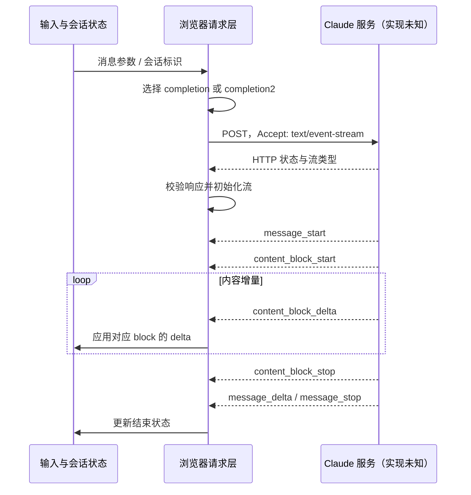

# Claude /new：前端还原与通信机制分析

采集日期：2026-10-26（Asia/Shanghai）  
目标：https://claude.ai/new  
范围：登录后的新建聊天页、主要输入与菜单状态，以及该页面公开加载的前端发布包。不是整个 Claude 产品或服务端代码的完整逆向。

## 交付与结论

已产出可运行的 React 本地还原、原始页面截图、样式变量、发布包副本、哈希清单和接口代码证据。聊天页面直接观察到 Tiptap / ProseMirror 编辑器；发布包中确认 React、ES Modules、Vite 依赖映射以及 SSE 消费代码。**可以还原浏览器端结构和协议处理逻辑，不能从这些材料恢复模型权重、服务端业务源码或完整后端架构。**

验证分为三个层级：

| 层级 | 本轮完成的工作 | 不能推出的结论 |
|---|---|---|
| 页面实测 | 在用户已打开的日常 Chrome 配置中登录并查看 /new，打开模型、Effort、附件与 Cowork 提示，检查输入态及桌面/手机布局 | 不代表账号可使用菜单里列出的全部模型或能力 |
| 静态代码确认 | 下载入口及其直接引用的 30 个 JS 模块、4 个 CSS，保留相关代码片段；REA 解析入口模块 | 代码存在不代表当前账号执行了该分支，也不是完整依赖闭包 |
| 本地还原验证 | 构建、Chrome 页面渲染、模型/强度选择、工具开关、流式模拟、历史搜索、手机布局 | 本地回复是明确标注的模拟，不是 Claude 推理；未与 Claude 私有接口联调 |

本轮没有发送真实测试消息、导出登录凭据或抓取请求/响应 HAR，因此**没有实测确认当前会话究竟使用 completion 还是 completion2、具体模型请求 ID、完整请求体、真实流式响应和计费行为**。接口说明以下载代码为依据，按静态证据陈述。

## 1. 页面与交互

当前会话显示 Free plan。以下模型名称只记录本次页面状态，不作为面向所有地区/账号的产品目录：Sonnet 5.5、Haiku 5.5、Opus 5.5、Fable 5.1；后两项显示升级入口。Effort 包括 Low、Medium（Recommended）、High、Extra、Max，Max 显示更高用量说明。

| 区域 | 实际观察 | 本地实现 |
|---|---|---|
| 侧栏 | 宽度 288px，可收起，有拖动分隔线；New、Projects、Artifacts、Code、Customize 和历史列表 | 可收起、拖动或方向键调整；历史使用示例数据；外围导航链接原站 |
| 标题 | Happy Monday, Eimy；衬线字体与橙色 Spark | 使用原站字体和 SVG，保留采集日文案 |
| 输入框 | 空输入时语音按钮；输入文字后变为发送按钮；contenteditable | 本地可编辑输入、Enter 发送、Shift+Enter 换行、组合输入保护 |
| 模型菜单 | 模型说明、付费门槛、Effort 子菜单 | 本地状态切换；付费模型显示说明，不伪装解锁 |
| 附件菜单 | Upload、Screenshot、Project、Skills、Connectors、Design system、Plugins、Web search、Memory | 本地文件名附件、移除及两个开关；外围服务说明占位 |
| Cowork | 当前 Free 账号弹出升级介绍 | 保留升级提示和 Later，未实现 Cowork 后台执行 |
| 手机 | 侧栏隐藏；标题居中分两行；输入框靠底部；Chat/Cowork 使用图标 | 390×844 检查；相同布局关系 |

原站浏览器扩展注入了翻译、配音和收藏悬浮按钮。它们不是 Claude 应用组成部分，本地源码没有复制这些插件。

## 2. 视觉与组件实现

主界面通过 DOM / computed style 读取的关键值：

| 属性 | 观察值 |
|---|---|
| 页面背景 | `--cds-page-bg: #fcfcfb` |
| 主文字 / 次文字 | `#0b0b0b` / `#52514e` |
| 输入区域 | 白色，圆角 14px，轻描边与 `0 4px 20px` 阴影 |
| 桌面输入框 | 在 1363×786 视口约宽 640px、高 103px |
| 桌面问候 | anthropic-serif，38px / 47.5px，weight 330，`"opsz" 48` |
| UI 正文 | anthropic-sans，主导航 14px |
| 图标 | `Anthropicons-Variable` 可变字体；Spark、语音和 incognito 为 SVG |
| 编辑器 | DOM class `tiptap ProseMirror`，role textbox，contenteditable |

资源保存在 `app/public/assets/`，运行时不热链原站字体/图片。原站组件带 `data-cds` 属性，并使用大量工具类及 `--cds-*` 变量；这说明存在统一的组件与设计 token 层。工具类形态与 Tailwind 风格一致，但没有根据类名断言完整源码配置或版本。

本地使用独立 React 组件和 CSS 还原，**没有将原站压缩代码作为可执行依赖**，也没有声称它就是原始 React 源码。原站压缩包保留在 evidence 中用于分析。

## 3. 前端模块结构

入口 `index-BQrL9ld_.js` 含 `__vite__mapDeps`，并通过 ES Modules 引入 `shared-*` 和 `vendor-*`。页面的 modulepreload 清单还包含 vendor-query、vendor-router、vendor-base-ui、vendor-tiptap、vendor-prosemirror、vendor-markdown、vendor-motion、vendor-zod 等名称。

`vendor-frame-m2pyE5UF.js` 内可见 React renderer、`createRoot`、`hydrateRoot` 等实现。模块名是依赖线索；明确的 React 和编辑器判断同时得到代码与 DOM 支持。未从文件名推断所有库的精确版本。

主要分析定位：

| 文件 | 作用/证据 |
|---|---|
| `index-BQrL9ld_.js` | 发布入口、模块依赖 |
| `shared-0-DP1OvXhA.js` | WQ 端点构造、POST/SSE、流事件分发、错误/重连处理 |
| `shared-17-BJYAMGb4.js` | completion_status 轮询与更新对话的 PUT 代码 |
| `shared-20-s5GlqyXi.js` | chat_conversations_v2 列表请求代码 |
| `shared-l-p-m-3-BEH6XcV3.js` | 对话详情 URL 和查询参数拼装 |
| `shared-2-DroTSEo1.js` | 文本/工具调用/思考 delta 类型判断 |
| `shared-l-p-m-1-7oe4NbZb.js` | react-query-cache、IndexedDB 缓存恢复相关代码 |

缓存结论是发布包具备相应机制，不代表读取过用户缓存内容。代码中也有数据脱敏、错误监控和 feature flag 逻辑，本轮未展开这些子系统。

## 4. 接口与传输

下面的路径是代码中的模板，不包含用户的组织 ID、对话 ID 或凭据。`{org}`、`{conversation}` 等为占位符。

| 接口模板 | 代码证据中的用途 | 方法/确认程度 |
|---|---|---|
| `/api/organizations/{org}/chat_conversations/{conversation}/completion` | 追加消息并生成 | POST；静态确认 |
| 同路径 `/completion2` | feature flag / backend 选择产生的另一分支 | POST；静态确认，当前命中分支未知 |
| 同路径 `/retry_completion`、`/retry_completion2` | 重新生成的对应分支 | POST；静态确认 |
| 同路径 `/completion_status?poll=true` | 查询生成状态，检查 pending / error 等情况 | GET；静态确认 |
| 同路径 `/completion_status?poll=false` | 另一状态查询键 | 路径静态确认 |
| `/api/organizations/{org}/chat_conversations_v2?...` | 对话列表加载 | 路径静态确认，未验证线上返回结构 |
| `/api/organizations/{org}/chat_conversations/{conversation}?...` | 对话详情，查询参数按调用条件构建 | 路径静态确认 |
| 同路径 `?rendering_mode=raw` | 更新对话，例如 project_uuid | PUT；静态确认 |
| 同路径 `/composer_notices`、`/composer_notices/action` | 输入区通知及其操作 | action 为 POST；静态确认 |
| 同路径 `/task/{task}/stop` | 停止一项任务 | POST；静态确认，不等同于所有对话的停止机制 |

`WQ` 函数先按操作选择 `completion` 或 `retry_completion`，再按分支决定是否追加字符 `2`，最后拼入组织与会话路径。代码内含 `claude_ai_clients_completions_use_bard` 开关。内部 c1/c2 标记不能推出物理部署、模型代号或服务端算法。

流式调用代码观察到：

- `method: "POST"`，`credentials: "include"`。
- 请求声明 `Content-Type: application/json` 和 `accept: text/event-stream`。
- 含 `anthropic-client-sha` 和条件性的 `anthropic-device-id`，另有未在此穷举的头构造函数。
- 支持条件性的 `Content-Encoding: gzip` 分支，不能假定所有请求都是明文 JSON。
- `onopen` 同时校验 HTTP 成功和 `Content-Type` 包含 `text/event-stream`；不符合时读取错误体并归一化异常。
- 使用 signal 处理取消，并有重试、断流检查、终止原因、消息 UUID 和状态恢复相关逻辑。

请求构建中可见 `rendering_mode: "messages"`、`completion_request_id`、`create_conversation_params`、`turn_message_uuids` 等字段线索，并合并上游参数对象。**不能仅凭局部片段写出完整、稳定、可直接调用的请求 schema。** 前端使用包含会话凭据的请求并不意味着把路径复制到脚本即可正常调用。

## 5. 流事件状态机

这是依据前端代码重建的协议处理路径，不是本轮网络抓包时序图。

静态事件枚举与处理分支包括：`ping`、`completion`、`error`、`message_start`、`message_delta`、`message_stop`、`content_block_start`、`content_block_delta`、`content_block_stop`、`message_limit`、`compaction_status`、`conversation_ready`、`tool_approval`、`mcp_auth_required` 等。存在不代表每次回复都会产生。

block 层按 index 创建和定位内容块；delta 层区分文本、thinking、input_json 等。代码还会处理多段 message_start、重连、重复消息 UUID 和未收到 stop_reason 的中断情况。所以完整客户端需要消息树与状态机，不能只把所有收到的 JSON 文本拼成字符串。

与普通原生 EventSource 的差别：此处代码使用 POST、请求体和 fetch 风格的 SSE 消费，不是仅靠 `new EventSource(url)` 发起 GET。

## 6. 证据如何复核

- `evidence/asset-manifest.json`：入口直接依赖及 CSS 的 URL、字节数、SHA-256。入口和后补字体由 `evidence/all-assets-sha256.json` 总表覆盖。
- `evidence/protocol-evidence.json`：128 个限定长度的代码片段，包含文件名、SHA-256、字符偏移和行号。片段用于定位，完整文件仍在 `evidence/assets/`。
- `evidence/static-findings.json`：关键词初筛结果，不是完整调用图。
- `evidence/dom-style.json`、`source-metrics.json`：DOM 资源清单、设计变量、字体及几何指标。
- `evidence/source-desktop.jpg`、`source-mobile.jpg`、`model-menu.jpg`、`attach-menu.jpg`、`cowork.jpg`、`composer-filled.jpg`：原站观察。
- `evidence/local-*.jpg`：本地验证截图。
- `evidence/rea-summary.json`：REA 对入口的结构分析摘要。parent evidence ID 为 `ev_cccf6a69041ec73c76b83ffbe4268c5747afa30a79390cb9e5a4c5d925809f6c`；1 个 JS 被解析，3984 个 AST 节点、222 项 findings，0 个解析失败。其余 30 个 JS 未进入 REA AST 分析，图覆盖为 partial；后续文本检查不能替代全量图分析。

## 7. 尚未验证的部分

1. 当前账号发送消息的实际 HTTP 请求/响应与 SSE 样本，认证/CSRF/设备验证全链路。
2. 上游参数对象的完整 schema，以及各字段在不同功能开关下的组合。
3. Projects、Artifacts、Customize 等子页面内部交互；本地导航通向原站。
4. 上传协议、文件处理、语音后端、Cowork 执行、远程连接器及付费模型能力。
5. 服务端内部实现、模型权重、真实调用成本、部署结构。
6. 原站代码更新后的兼容性。本报告与还原对应此次采集版本。

如需继续深入，最有价值的下一步是：在同一日常 Chrome 中记录一次专门的无敏感内容测试消息，保留经脱敏的请求体、响应头与 SSE 事件，再逐项对应这里的静态处理分支。本轮未把这一步写成已经完成。
